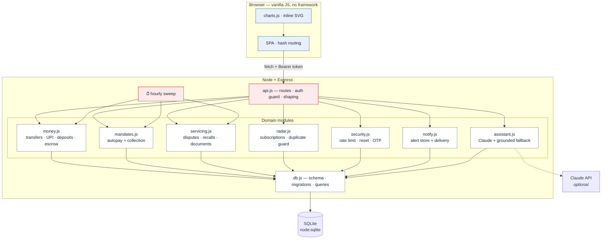
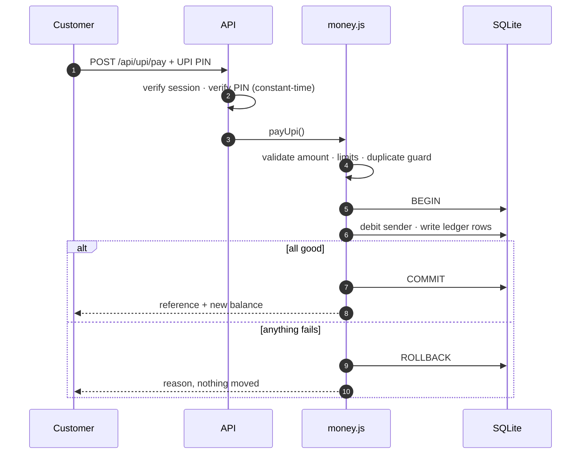

<div align="center">

<h1>AB Pay</h1>

**An Indian net-banking application — UPI, transfers, deposits, cards,<br>and a bank that resolves its own support tickets.**

<p>


</p>

<sub>No build step · No database server · No native modules · Three dependencies</sub>

</div>

---

## Quick start

```bash
git clone https://github.com/Aahan0605/banking-website.git
cd banking-website
npm install
npm start
```

The console prints the address to open and the demo sign-in details.

```bash
npm run test:all        # 128 self-checks — no network, no API key
```

---

## System architecture



**Layering.** The browser never talks to the database. Every private route resolves the account from a verified session token — never from an id the client supplies — so one customer can never read or move another's money.

**The sweep.** Escrow expiry, recurring-deposit instalments, autopay collection and scheduled transfers run hourly *and* on page load, so an idle server never shows stale figures.

### How a payment moves



---

## What makes it different

Payment apps compete on *sending* money. The expensive part for a bank is everything **after** the payment — so that is where this one is built.

| | |
| :-- | :-- |
| **Safe Send** | Escrow for paying strangers. Money leaves your balance but is **held by the bank** — the seller sees it's committed but can't touch it. You release it on delivery; if you never do, it refunds itself. |
| **Money Radar** | Finds recurring payments, shows what each costs **per year**, and flags a **price rise** against what it *used* to cost — so it stays visible after the new price has been billed a few times. |
| **Autopay with a real ceiling** | A merchant that raises its price **above your approved limit** is refused, not charged. An unfundable debit is skipped, never forced, and the cycle doesn't advance. |
| **Self-resolving support** | A duplicate charge refunds on the spot; an unconfirmed payment auto-reverses when the settlement window lapses. **Only fraud reaches a human.** |
| **Abhi** | AI customer care grounded in *your* account. Uses Claude when a key is configured, a deterministic offline engine when not. |

---

## Feature map

| Area | |
| :-- | :-- |
| **UPI** | Scan any NPCI `upi://` QR · pay by UPI ID or mobile · request money · UPI PIN · ₹1 lakh cap |
| **Transfers** | IMPS / NEFT / RTGS to **any Indian bank** via IFSC — the payee needs no AB Pay account · scheduled & repeating |
| **Deposits** | FD & RD at card rates · live maturity quote · instalments genuinely collected |
| **Cards** | Block instantly · per-channel switches · daily limit · wallet for other banks' cards |
| **Money** | Spending charts with date ranges · statement search, paging, CSV · instant certificates |
| **Security** | Login rate limiting · password reset · optional 2FA · full data export |

---

## How the money is kept honest

| | |
| :-- | :-- |
| **Integers, never floats** | Balances are paise. Repeated transfers cannot accumulate drift. |
| **Atomic** | Every balance change runs inside a SQLite transaction and rolls back whole. |
| **Ownership from the token** | Private routes resolve the account from the verified session, never a client-supplied id. |
| **Validated before it moves** | NaN, zero, negative, sub-paise, over-limit, self-payment and unknown payees are all rejected first. |
| **UPI needs the PIN** | Checked with a constant-time comparison. |

The suite covers token forgery, balance conservation, overdraft refusal, FD/RD interest maths, the full escrow lifecycle including double-release, every branch of the dispute engine, autopay caps, and that one customer's data never reaches another's AI prompt.

---

## Project layout

```
├── server.js              Express bootstrap · static hosting · hourly sweep
├── src/
│   ├── api.js             REST routes, auth guard, response shaping
│   ├── db.js              Schema, migrations, queries
│   ├── money.js           Transfers, UPI, deposits, Safe Send escrow
│   ├── mandates.js        Autopay mandates and their collection run
│   ├── servicing.js       Dispute auto-resolution, recalls, documents
│   ├── radar.js           Subscription detection, duplicate guard
│   ├── assistant.js       AI customer care
│   ├── security.js        Rate limiting, password resets, one-time codes
│   ├── notify.js          Notification store and delivery
│   ├── ifsc.js            Offline IFSC validation and bank decoding
│   ├── catalog.js         Operator plans and BBPS billers
│   └── payee.js           Real-world UPI address (environment only)
├── public/                Client app — index.html · app.js · charts.js · styles.css
├── practicals/            OST lab practicals 6–10 — see practicals/README.md
├── test.js                117 checks — money, servicing, security
└── test-assistant.js      11 checks — AI integration, stubbed SDK
```

---

## Configuration

Every variable is optional; the app runs with none of them set.

| Variable | Default |
| :-- | :-- |
| `PORT` | `3000` |
| `DB_FILE` | `./abpay.db` |
| `SESSION_SECRET` | generated into `.session-secret` |
| `ANTHROPIC_API_KEY` | unset — the assistant uses its offline engine |
| `NOTIFY_WEBHOOK` | unset — alerts are written to the log |
| `RECEIVE_UPI_ID` | unset — the public pay page shows a placeholder |

> [!IMPORTANT]
> **`RECEIVE_UPI_ID` is the only setting that moves real money.** A UPI ID is usually a phone number, so it is never committed to the repository. Set it and the public pay page collects genuine payments; leave it unset and the page states plainly that it is a placeholder.

See [`.env.example`](.env.example) for a template.

---

## Scope

> [!NOTE]
> A demonstration application. **AB Pay is fictional**, it is not connected to the real UPI network or BBPS, and rates and plans are indicative samples. It holds no real money — do not store anything sensitive in it.

Balances at other banks are **not** shown for linked accounts. No bank releases those on the strength of an account number; in India that requires the customer's consent through RBI's Account Aggregator framework. The application says so rather than inventing a figure.

---

<div align="center">
<sub><a href="LICENSE">MIT</a></sub>
</div>
